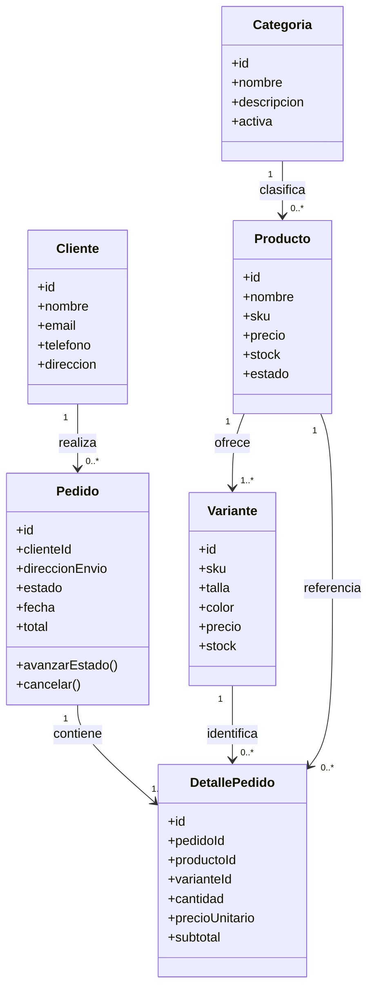
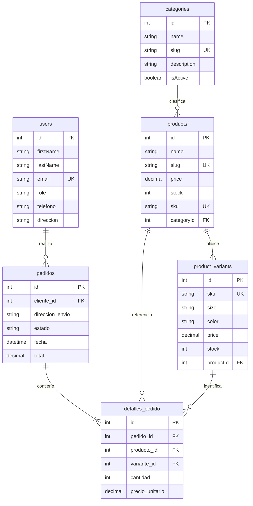

# Modelo de dominio y arquitectura

## Diagrama de clases del dominio

`Cliente` corresponde al usuario con rol `customer`; las cuentas administrativas son usuarios con rol `admin`. `Producto.stock` es un total derivado de las variantes; la existencia por talla/color se conserva en `Variante.stock`.

## Diagrama de datos persistentes

Las claves foráneas, restricciones e índices se crean mediante las migraciones versionadas de `database/migrations/`. Los nombres físicos de columnas coinciden con `field` en los modelos Sequelize.

## Diagrama de capas y recorrido de una solicitud

```mermaid
flowchart LR
    ClienteHTTP[Cliente HTTP o Swagger] --> Rutas[presentation: rutas y middlewares]
    Rutas --> DTO[presentation: DTO y validaciones]
    DTO --> Controlador[presentation: controlador]
    Controlador --> Servicio[application: servicio de caso de uso]
    Servicio --> RepoContrato[domain: contrato de repositorio]
    RepoContrato --> RepoSQL[infrastructure: repositorio Sequelize]
    RepoSQL --> Modelo[infrastructure: modelo ORM]
    Modelo --> MySQL[(MySQL / MariaDB)]
    MySQL --> Modelo --> RepoSQL --> Servicio --> Controlador
```

Ejemplo verificable: `POST /pedidos` valida el DTO en `presentation`, autoriza al propietario o al administrador en el controlador, delega el caso de uso y ejecuta en el repositorio SQL una transacción con el pedido, sus detalles y el descuento de inventario. El repositorio devuelve el pedido y el controlador responde `201`.
